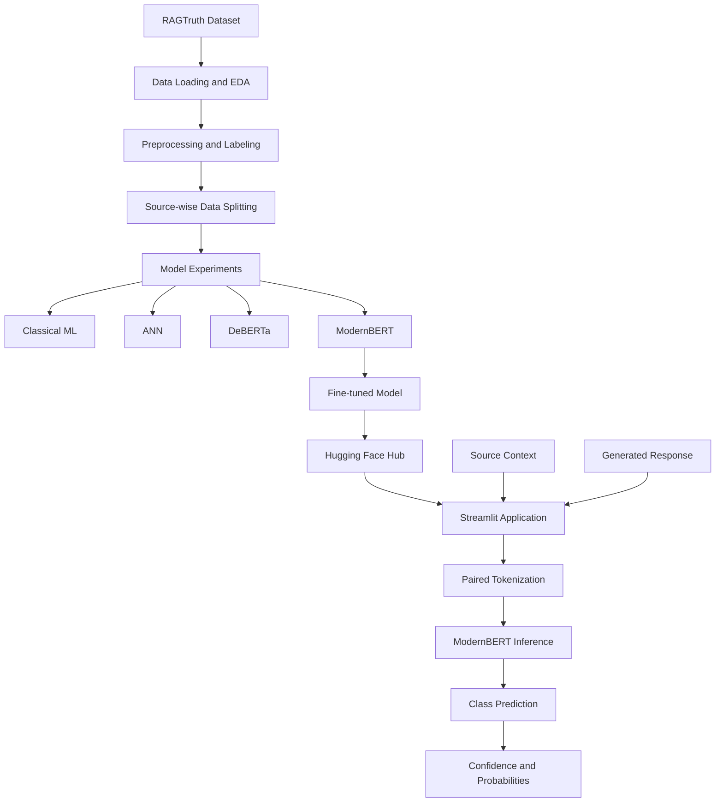

# 🛡️ RAGGuard
### A Transformer-Based Framework for Detecting Hallucinations in Retrieval-Augmented Generation Systems

RAGGuard is a research-oriented framework designed to detect hallucinations in AI-generated responses by evaluating their consistency with retrieved source context.

The project investigates multiple machine learning and deep learning approaches before fine-tuning **ModernBERT-base** as the final transformer-based classifier. It provides a web application where users can submit source context and an AI-generated response to obtain a hallucination prediction, confidence score, and class probabilities.

<p align="center">
  <a href="https://ragguard.streamlit.app/"><strong>🚀 Live Demo</strong></a> |
  <a href="https://huggingface.co/Yashika22/ragguard-modernbert"><strong>🤗 Hugging Face Model</strong></a> |
  <a href="https://github.com/yashikarathi24/RagGuard"><strong>💻 GitHub Repository</strong></a>
</p>

---

## 📌 Table of Contents

- [Project Overview](#-project-overview)
- [Problem Statement](#-problem-statement)
- [Objectives](#-objectives)
- [Dataset](#-dataset)
- [Methodology](#-methodology)
- [Experimental Journey](#-experimental-journey)
- [Final Model: ModernBERT](#-final-model-modernbert)
- [Results and Evaluation](#-results-and-evaluation)
- [System Architecture](#-system-architecture)
- [Application Features](#-application-features)
- [Technology Stack](#-technology-stack)
- [Project Structure](#-project-structure)
- [Installation and Setup](#-installation-and-setup)
- [Usage](#-usage)
- [Model Hosting and Deployment](#-model-hosting-and-deployment)
- [Limitations](#-limitations)
- [Future Improvements](#-future-improvements)
- [Research and References](#-research-and-references)

---

## 🔍 Project Overview

Large Language Models (LLMs) can generate responses that sound convincing but contain information that is unsupported by the provided context. This problem becomes particularly important in Retrieval-Augmented Generation (RAG) systems, where generated answers are expected to remain grounded in retrieved documents.

RAGGuard approaches this problem as a **binary text classification task**.

Given:
1. A retrieved source context.
2. An AI-generated response.

The fine-tuned transformer evaluates the relationship between the two inputs and predicts whether the response is supported by the supplied context or contains hallucinated information.

**Classification labels:**

| Label | Class | Meaning |
|---|---|---|
| 0 | Supported | No hallucination annotation |
| 1 | Hallucinated | One or more hallucination annotations |

The system uses paired source-response inputs rather than evaluating the generated response in isolation.

## 🎯 Problem Statement

To develop a transformer-based framework capable of identifying unsupported or conflicting information in AI-generated responses by analyzing their consistency with the retrieved source context.

## 🎯 Objectives

- Explore the RAG hallucination detection problem using the RAGTruth dataset.
- Perform exploratory data analysis and preprocessing.
- Establish classical machine learning baselines using TF-IDF features.
- Investigate neural network and transformer-based approaches.
- Fine-tune ModernBERT for paired source-response classification.
- Evaluate model performance using accuracy, precision, recall, and F1-score.
- Develop an interactive Streamlit application for hallucination detection.
- Host the trained model on Hugging Face and deploy the application publicly.

---

## 📊 Dataset

**Dataset:** RAGTruth

RAGTruth provides annotated examples of hallucinations in responses generated by retrieval-augmented language models.

The project uses two JSONL files:

- `response.jsonl` — generated responses and their hallucination annotations.
- `source_info.jsonl` — corresponding source information.

### Dataset Statistics

| Attribute | Count |
|---|---:|
| Total responses | 17,790 |
| Unique source documents | 2,965 |
| Responses with hallucination annotations | 7,664 |
| Responses without hallucination annotations | 10,126 |
| Total hallucination annotations | 14,289 |

### Hallucination Categories

| Category | Count |
|---|---:|
| Evident Baseless Info | 6,237 |
| Evident Conflict | 5,324 |
| Subtle Baseless Info | 2,527 |
| Subtle Conflict | 201 |

### Data Preprocessing

The preprocessing pipeline included:

- Loading and merging response and source information using `source_id`.
- Converting hallucination annotations into binary classification labels.
- Filtering incorrect refusals and truncated responses.
- Basic whitespace and text cleanup.
- Retaining meaningful linguistic information, including negations.
- Removing data leakage by splitting at the source-document level.

After quality filtering, the modeling dataset contained **17,617 responses**.

### Final Dataset Split

| Split | Samples | Supported | Hallucinated |
|---|---:|---:|---:|
| Training | 13,447 | 7,419 | 6,028 |
| Validation | 1,495 | 825 | 670 |
| Testing | 2,675 | 1,732 | 943 |
| **Total** | **17,617** | **9,976** | **7,641** |

The split was designed to prevent source documents from appearing across training and testing sets.

---

## ⚙️ Methodology

The project followed an experimental approach involving multiple model families.

### 1. Exploratory Data Analysis

The dataset was analyzed to understand:

- Class distribution.
- Hallucination categories.
- Source and response lengths.
- Data quality.
- Duplicate responses and source relationships.

### 2. Feature Engineering

TF-IDF was used to convert text into numerical representations.

Configuration:

- Maximum features: 5,000
- N-gram range: (1, 2)

### 3. Classical Machine Learning

The following algorithms were investigated:

- Logistic Regression
- Naive Bayes
- Support Vector Machine (SVM)
- Random Forest

### 4. Neural Network Experiments

An Artificial Neural Network was developed using TF-IDF features.

Architecture:

- Input layer: 5,000 features
- Dense layer: 128 neurons, ReLU
- Dropout: 0.3
- Dense layer: 64 neurons, ReLU
- Dropout: 0.3
- Output layer: 1 neuron, Sigmoid

### 5. Transformer Exploration

DeBERTa-v3-base was investigated as a transformer-based approach.

However, its 512-token maximum position limit created a sequence-length constraint. Approximately 72.2% of the examples exceeded this limit when source and response lengths were considered together.

This motivated the exploration of ModernBERT, which supports substantially longer input sequences.

### 6. ModernBERT Fine-Tuning

ModernBERT-base was selected for the final model because of its longer context capacity and ability to process paired source-response inputs.

---

## 🧪 Experimental Journey

RAGGuard was developed through iterative experimentation rather than selecting a single architecture from the beginning.

### Classical Machine Learning Results

The following results were obtained during the earlier classical ML experiments.

| Model | Accuracy | Hallucination Precision | Hallucination Recall | Hallucination F1 |
|---|---:|---:|---:|---:|
| Logistic Regression | 76.86% | 0.70 | 0.60 | 0.65 |
| Naive Bayes | 74.39% | 0.64 | 0.61 | 0.63 |
| SVM | 77.79% | 0.74 | 0.57 | 0.64 |
| Random Forest | 78.09% | 0.74 | 0.59 | 0.65 |

Random Forest achieved the highest reported accuracy among these classical experiments.

**Note:** These results came from an earlier experimental split and are not a strictly controlled, same-split comparison with the final ModernBERT results.

### ANN Results

The ANN was evaluated on the quality-filtered dataset split.

| Metric | Result |
|---|---:|
| Test Accuracy | 70.58% |
| Hallucination Precision | 0.57 |
| Hallucination Recall | 0.69 |
| Hallucination F1 | 0.62 |

The ANN demonstrated useful hallucination recall, but validation performance showed signs of overfitting during training.

### DeBERTa Exploration

DeBERTa-v3-base was investigated as an intermediate transformer experiment.

The maximum sequence length of 512 tokens limited its ability to process longer source-response pairs without truncation.

ModernBERT was subsequently explored to address this limitation.

---

## 🤖 Final Model: ModernBERT

**Base Model:** `answerdotai/ModernBERT-base`

**Fine-tuned Model:** [Yashika22/ragguard-modernbert](https://huggingface.co/Yashika22/ragguard-modernbert)

### Model Configuration

| Parameter | Configuration |
|---|---|
| Architecture | ModernBERT-base |
| Parameters | Approximately 149M |
| Transformer Layers | 22 |
| Hidden Size | 768 |
| Maximum Input Length | 4,096 tokens |
| Number of Classes | 2 |
| Optimizer | AdamW |
| Learning Rate | 2e-5 |
| Weight Decay | 0.01 |
| Epochs | 2 |
| Batch Size | 2 |
| Gradient Accumulation Steps | 4 |
| Effective Batch Size | 8 |
| Training Environment | Google Colab, Tesla T4 |

Class weights were used to account for class imbalance.

### Input Representation

The model receives two related text sequences:

- Source context
- Generated response

Both are passed through the tokenizer as paired inputs. The model then generates classification logits, which are converted into class probabilities using softmax.

The final classification uses a threshold of 0.50.

---

## 📈 Results and Evaluation

The final ModernBERT model was evaluated on the held-out test set containing 2,675 examples.

### Final Test Performance

| Evaluation Metric | Result |
|---|---:|
| Accuracy | **81.12%** |
| Hallucination Precision | **74.07%** |
| Hallucination Recall | **71.47%** |
| Hallucination F1-score | **72.75%** |
| Test Loss | 0.4385 |

### Validation Performance

The best validation checkpoint was obtained at Epoch 2.

| Metric | Result |
|---|---:|
| Validation Accuracy | 78.66% |
| Hallucination Precision | 79.01% |
| Hallucination Recall | 71.34% |
| Hallucination F1-score | 74.98% |
| Validation Loss | 0.4744 |

### Evaluation Interpretation

The final model achieved 81.12% test accuracy and a hallucination F1-score of 72.75%.

The results indicate that ModernBERT can learn useful patterns for identifying unsupported or conflicting information in generated responses. However, the model still produces false positives and false negatives, demonstrating that hallucination detection remains a challenging classification problem.

---

## 🏗️ System Architecture

RAGGuard follows a complete machine learning pipeline, from dataset preparation and model experimentation to deployment and inference.



### Inference Workflow

1. **Input:** User provides retrieved source context and generated response.
2. **Tokenization:** The tokenizer processes both inputs as a paired sequence.
3. **Inference:** Fine-tuned ModernBERT evaluates the input pair.
4. **Classification:** The model predicts Supported or Hallucinated.
5. **Output:** The application displays the predicted class, confidence score, and class probabilities.

---

## 🖥️ Application Features

RAGGuard includes an interactive Streamlit application.

### Key Features

- Separate input fields for source context and generated response.
- Paired-text processing using the fine-tuned ModernBERT model.
- Binary hallucination classification.
- Prediction confidence score.
- Individual class probabilities.
- Cached model loading to avoid unnecessary repeated downloads and initialization.
- Public deployment through Streamlit Community Cloud.

**Live Application:** [https://ragguard.streamlit.app/](https://ragguard.streamlit.app/)

---

## 🧰 Technology Stack

| Category | Technologies |
|---|---|
| Programming Language | Python |
| Data Processing | Pandas, NumPy |
| Classical ML | Scikit-learn |
| Deep Learning | PyTorch |
| NLP and Transformers | Hugging Face Transformers |
| Transformer Architecture | ModernBERT |
| Feature Extraction | TF-IDF |
| Model Evaluation | Scikit-learn |
| Model Hosting | Hugging Face Hub |
| Web Application | Streamlit |
| Development Environment | Google Colab, VS Code |
| Version Control | Git, GitHub |
| Deployment | Streamlit Community Cloud |

---

## 📁 Project Structure

```text
RAGGuard/
│
├── Dataset/
│   ├── response.jsonl
│   └── source_info.jsonl
│
├── Models/
│   └── modernbert_final/
│       ├── config.json
│       ├── tokenizer.json
│       └── tokenizer_config.json
│
├── Notebooks/
│   ├── EDA and preprocessing experiments
│   ├── Classical ML experiments
│   ├── ANN experiments
│   ├── CNN/RNN exploratory experiments
│   ├── DeBERTa experiments
│   └── ModernBERT experiments
│
├── Processed data/
│   └── Processed datasets and vectorization artifacts
│
├── Results/
│   └── Evaluation metrics and training results
│
├── src/
│   ├── __init__.py
│   ├── model_loader.py
│   ├── predictor.py
│   └── preprocessing.py
│
├── app.py
├── requirements.txt
├── README.md
└── .gitignore
```

**Note:** The large trained model weights are hosted on Hugging Face rather than committed to GitHub. The local model directory is used for development when needed.

---

## 💻 Installation and Setup

### 1. Clone the Repository

```bash
git clone https://github.com/yashikarathi24/RagGuard.git
cd RagGuard
```

### 2. Create a Virtual Environment

```bash
python -m venv venv
```

Activate it:

**Windows:**

```bash
venv\Scripts\activate
```

**Linux/macOS:**

```bash
source venv/bin/activate
```

### 3. Install Dependencies

```bash
pip install -r requirements.txt
```

### 4. Run the Application

```bash
python -m streamlit run app.py
```

The application will open in your browser.

The fine-tuned model is downloaded from the public Hugging Face repository when the application first loads it.

---

## 🚀 Usage

1. Open the RAGGuard application.
2. Paste the retrieved document or source passage into the **Source Context** field.
3. Paste the AI-generated answer into the **Generated Response** field.
4. Click **Analyze Response**.
5. View the predicted class, confidence score, and class probabilities.

**Example:**

Source Context:

> The Eiffel Tower is located in Paris, France. It was completed in 1889.

Generated Response:

> The Eiffel Tower is located in Berlin, Germany. It was completed in 1920.

The application evaluates whether the generated response is consistent with the supplied source context.

---

## ☁️ Model Hosting and Deployment

### Hugging Face

The fine-tuned ModernBERT model is hosted on Hugging Face Hub.

**Model Repository:**  
https://huggingface.co/Yashika22/ragguard-modernbert

The repository contains the trained model weights, configuration, and tokenizer files.

### Streamlit Community Cloud

The RAGGuard application is deployed using Streamlit Community Cloud.

**Live Application:**  
https://ragguard.streamlit.app/

The application loads the model directly from Hugging Face, avoiding the need to store large model weights in the GitHub repository.

---

## ⚠️ Limitations

RAGGuard is an experimental hallucination detection framework and has several limitations.

1. **Context Dependence:** The model evaluates consistency with the supplied source context. It does not independently verify facts against external knowledge.

2. **False Negatives:** Some hallucinated responses may be classified as Supported.

3. **False Positives:** Correct responses may sometimes be classified as Hallucinated.

4. **Dataset Dependence:** Model performance is influenced by the characteristics and annotation patterns of the RAGTruth dataset.

5. **Sequence Length:** Inputs exceeding the configured maximum sequence length may be truncated.

6. **Generalization:** Performance on unseen domains, datasets, and different styles of generated responses requires further evaluation.

7. **Confidence Interpretation:** Prediction probabilities represent model confidence, not a guarantee of factual correctness.

---

## 🔮 Future Improvements

Potential directions for improving RAGGuard include:

- Experimenting with threshold optimization for different application requirements.
- Improving hallucination recall and reducing false negatives.
- Evaluating performance across additional hallucination datasets.
- Investigating more advanced transformer architectures.
- Adding sentence-level hallucination localization.
- Supporting multi-class hallucination categorization.
- Incorporating explainability methods to highlight unsupported claims.
- Integrating RAGGuard directly into an end-to-end RAG pipeline.
- Evaluating model calibration and robustness under domain shifts.

---

## 📚 Research and References

- **RAGTruth:** RAG hallucination detection dataset and research.
- **ModernBERT:** [Answer.AI ModernBERT](https://huggingface.co/answerdotai/ModernBERT-base)
- **Fine-tuned RAGGuard Model:** [Yashika22/ragguard-modernbert](https://huggingface.co/Yashika22/ragguard-modernbert)
- **Hugging Face Transformers:** [Documentation](https://huggingface.co/docs/transformers)
- **Streamlit:** [Documentation](https://docs.streamlit.io/)

---

## 👩‍💻 Project

**RAGGuard — Transformer-Based Hallucination Detection for Retrieval-Augmented Generation Systems**

Developed as an experimental machine learning project exploring classical ML, neural networks, and transformer-based approaches to hallucination detection.

- **Live Demo:** https://ragguard.streamlit.app/
- **GitHub:** https://github.com/yashikarathi24/RagGuard
- **Hugging Face:** https://huggingface.co/Yashika22/ragguard-modernbert

---

*RAGGuard aims to make AI-generated responses more context-aware and reliable by identifying information that is unsupported by retrieved evidence.*
